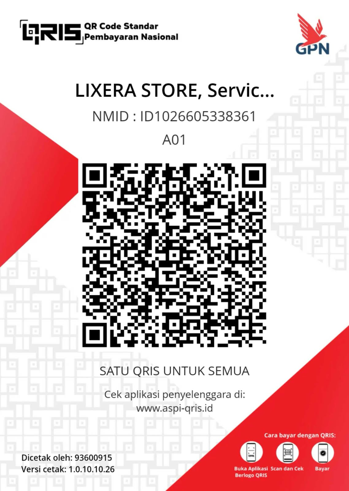

<!DOCTYPE html>
<html lang="id">
<head>
<meta charset="UTF-8">
<meta name="viewport" content="width=device-width, initial-scale=1">
<meta name="theme-color" content="#050914">
<title>LIXERA TOP UP</title>

</head>
<body>
<header>

LX LIXERA<small>TOP UP • DIGITAL GAMING</small>

</header>

<main class="wrap">
<section class="hero">

YOUR DIGITAL GAME PARTNER

<h1>TOP UP GAME. LEVEL UP.</h1>

Top up game favoritmu di LIXERA. Pilih game, pilih paket, isi data akun, lalu konfirmasi pesanan ke WhatsApp admin.

⚡ Praktis • Harga jelas • Konfirmasi admin

</section>

<h2>Katalog Top Up</h2>
<input class="search" id="search" placeholder="Cari game atau paket...">

Paket tidak ditemukan.

<strong>INFORMASI PENTING</strong> 
Pastikan Player ID dan server benar sebelum memesan. Jangan pernah memberikan password atau kode OTP akun. Pembayaran diverifikasi manual oleh admin. Harga dan ketersediaan paket dapat berubah.

</main>

<footer>
LIXERA TOP UP — Kebutuhan Digital Gaming ©  LIXERA
</footer>

<h2>Form Pesanan</h2><button class="close" id="close">Tutup ✕</button>

Pastikan data pesanan benar sebelum melanjutkan.

<strong id="chosenName"></strong>

<form id="orderForm">

<label>Player ID / User ID *</label><input id="playerId" required placeholder="ID pemain">

<label>Server / Zone ID</label><input id="server" placeholder="Jika diperlukan">

<label>Nama pemesan *</label><input id="buyerName" required placeholder="Nama kamu">

<label>Nomor WhatsApp *</label><input id="buyerWa" required inputmode="tel" placeholder="08xxxxxxxxxx">

<label>Metode pembayaran *</label>
<select id="payment" required>
<option value="">Pilih pembayaran</option>
<option>QRIS</option><option>DANA</option><option>GoPay</option>
</select>

<label>Catatan (opsional)</label><input id="note" placeholder="Catatan tambahan">

<strong>Informasi Pembayaran</strong>

Pilih metode pembayaran.

DANA: 083165700636

GoPay: 083165700636

Nama pembayaran: YAXXX

Untuk QRIS, upload gambar bernama IMG-20261010-WA0017.jpg ke folder yang sama dengan index.html. Pastikan tujuan dan nominal pembayaran benar.

Total pesanan

<button class="primary" type="submit">KONFIRMASI VIA WHATSAPP ↗</button>

Pesanan belum diproses sampai pembayaran diverifikasi admin.

</form>

</body>
</html>
